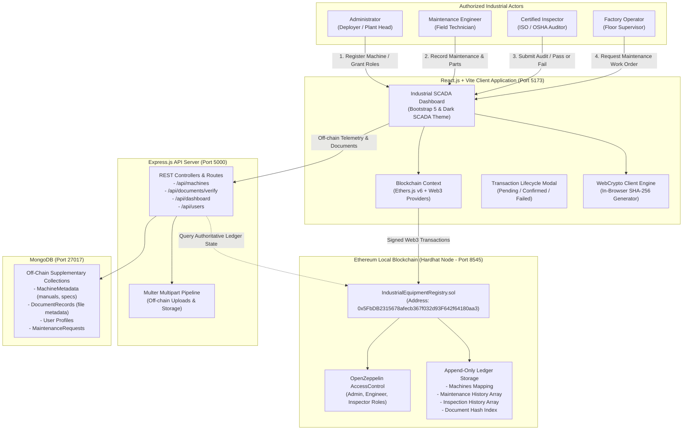
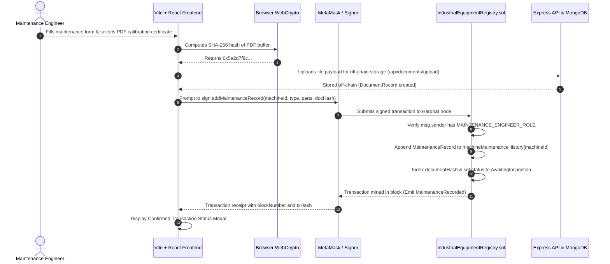

# Blockchain-Based Industrial Equipment Maintenance and Service History Management System

A production-grade, decentralized engineering asset ledger built for final-year B.Tech CSE project demonstration. This system provides a **tamper-evident, append-only service history** for heavy industrial equipment, eliminating single points of failure and unauthorized alteration of machine logs.

---

## 1. Problem Statement

In heavy manufacturing and precision industries (aerospace, automotive stamping, CNC machining, chemical processing), equipment reliability and safety compliance are mission-critical. Traditional maintenance management systems rely on centralized databases (SQL/NoSQL) administered by a single factory authority or software vendor.

### Flaws in Centralized Records:
1. **Privilege Vulnerability**: Database administrators or management personnel with elevated access can alter, backdate, or delete embarrassing maintenance failure logs to pass safety audits or maintain insurance ratings.
2. **Multi-Party Distrust**: Equipment manufacturers (OEMs), third-party maintenance contractors, factory operators, and certified ISO/OSHA inspectors have conflicting interests and lack a single source of mutual truth.
3. **Counterfeit Replacement Parts**: Unauthorized sub-standard parts can be installed without an immutable cryptographic paper trail linking serial numbers to the servicing technician.
4. **Altered Compliance Certificates**: Paper or PDF certificates can be forged or tampered with without immediate automated detection.

---

## 2. Proposed Solution

This system combines an **Ethereum Solidity smart contract** on a local Hardhat network with an **Express.js API** and a **Vite + React.js** industrial dashboard:

- **On-Chain Immutability**: All equipment registration, maintenance actions, and regulatory inspection outcomes are committed directly to an append-only smart contract ledger (`IndustrialEquipmentRegistry.sol`). Once mined, records cannot be modified, overwritten, or deleted by any user or administrator.
- **Cryptographic Role-Based Access Control (RBAC)**: Smart contract operations enforce OpenZeppelin `AccessControl`. Only cryptographic wallets assigned the required role can sign transactions for machine registration (`DEFAULT_ADMIN_ROLE`), maintenance recording (`MAINTENANCE_ENGINEER_ROLE`), or inspection certification (`INSPECTOR_ROLE`).
- **Cryptographic Document Anchoring**: Rather than congesting the blockchain with heavy PDF manuals or calibration logs, files are digested client-side using **SHA-256**. The resulting 256-bit hash is permanently registered on-chain, while the physical payload resides in off-chain storage.
- **Instant Tamper Verification**: Any party can upload a maintenance certificate or inspection sheet; the system computes its SHA-256 digest in real-time and queries the smart contract to confirm whether the document exactly matches the authentic on-chain submission (`VERIFIED`), is modified/counterfeit (`VERIFICATION FAILED`), or was never recorded (`NO RECORD FOUND`).

---

## 3. System Architecture

The following Mermaid diagram details the interactions between physical actors, the React frontend, the Express backend, MongoDB off-chain storage, and the Ethereum local blockchain node.



---

## 4. Data Flow



---

## 5. Technology Stack

| Layer | Technologies Used | Description |
|---|---|---|
| **Blockchain** | Solidity 0.8.24, Hardhat, OpenZeppelin v5, Ethers.js v6 | Smart contract development, automated testing, local node, role-based security |
| **Frontend** | React 18, Vite 5, React Router v6, Bootstrap 5, Chart.js | SCADA-themed responsive UI, interactive append-only timeline, WebCrypto hashing |
| **Backend** | Node.js, Express.js, Multer, Crypto | REST APIs for off-chain document storage, user profiles, and supplementary specs |
| **Database** | MongoDB, Mongoose v8 | Off-chain storage for manuals, telemetry, and pending operator work orders |
| **Dev Tools** | PowerShell, VS Code, MetaMask | Local EVM execution, testing, and wallet transaction signing |

---

## 6. User Roles and Smart Contract Permissions

| Role | Cryptographic Identifier | Smart Contract Capabilities | Permitted System Actions |
|---|---|---|---|
| **Administrator** | `DEFAULT_ADMIN_ROLE` (`0x00...00`) | `registerMachine()`, `authorizeEngineer()`, `authorizeInspector()`, `revokeEngineerAuthorization()`, `revokeInspectorAuthorization()` | Register industrial equipment, assign machine IDs, authorize/revoke technical personnel, view audit logs. |
| **Maintenance Engineer** | `MAINTENANCE_ENGINEER_ROLE` (`keccak256(...)`) | `addMaintenanceRecord()`, `updateMachineStatus()` | Record maintenance actions, document replaced part serial numbers, attach cryptographic certificate hashes. |
| **Inspector** | `INSPECTOR_ROLE` (`keccak256(...)`) | `addInspectionRecord()` | Conduct regulatory audits (ISO/OSHA), mark inspections as PASSED or FAILED, attach tamper-evident evidence. |
| **Factory Operator** | `FACTORY_OPERATOR_ROLE` (`keccak256(...)`) | `updateMachineStatus()` | View machine status, submit maintenance request tickets to off-chain queue. |
| **Auditor / Guest** | Read-Only | Public Viewers | View full chronological append-only machine timeline, verify document SHA-256 hashes against on-chain records. |

---

## 7. Prerequisites

Before running the application, ensure your machine has:
1. **Node.js**: v18.0.0 or higher (`node -v`)
2. **npm**: v9.0.0 or higher (`npm -v`)
3. **MongoDB**: Installed and running on `mongodb://127.0.0.1:27017`
4. **MetaMask**: Browser extension installed in Chrome, Brave, or Firefox

---

## 8. Installation & Setup

### Clone Repository & Navigate
```bash
cd d:\BlockChain
```

### Install All Dependencies
```bash
# 1. Install Blockchain dependencies
cd blockchain
npm install

# 2. Install Backend dependencies
cd ../backend
npm install

# 3. Install Frontend dependencies
cd ../frontend
npm install
cd ..
```

---

## 9. Running the System

You can launch all services in separate terminal windows with a single command, or manually in dedicated terminals.

### Method A: One-Click Master Launcher (Windows)
Double-click `start-all.bat` or run in terminal:
```bash
.\start-all.bat
```

### Method B: Manual Step-by-Step Terminal Execution

#### Terminal 1: Start Hardhat Ethereum Local Node
```bash
cd d:\BlockChain\blockchain
npx hardhat node
```
*Node starts on `http://127.0.0.1:8545` with Chain ID `31337`.*

#### Terminal 2: Deploy Smart Contract to Localhost
```bash
cd d:\BlockChain\blockchain
npx hardhat run scripts/deploy.js --network localhost
```
*This deploys `IndustrialEquipmentRegistry.sol`, authorizes initial roles, seeds sample machines and records, and exports `contractData.json` to both frontend and backend.*

#### Terminal 3: Seed Database & Start Backend API Server
```bash
cd d:\BlockChain\backend
node src/seed.js
npm start
```
*Backend runs on `http://localhost:5000` (Health Check: `http://localhost:5000/api/health`).*

#### Terminal 4: Start Frontend Client Application
```bash
cd d:\BlockChain\frontend
npm run dev
```
*Frontend runs on `http://localhost:5173`.*

---

## 10. Configuring MetaMask for Local Testing

1. Open MetaMask and click the **Network Selector** dropdown (top-left).
2. Click **Add Network** -> **Add a network manually**:
   - **Network Name**: `Hardhat Localhost`
   - **New RPC URL**: `http://127.0.0.1:8545`
   - **Chain ID**: `31337`
   - **Currency Symbol**: `ETH`
3. Click **Save** and switch to this network.
4. Import the pre-funded Hardhat test accounts into MetaMask using their private keys:

| Role | Account Name | Public Address | Private Key (Import into MetaMask) |
|---|---|---|---|
| **Admin** | Chief Engineer Marcus | `0xf39Fd6e51aad88F6F4ce6aB8827279cffFb92266` | `0xac0974bec39a17e36ba4a6b4d238ff944bacb478cbed5efcae784d7bf4f2ff80` |
| **Engineer** | Elena Rostova | `0x70997970C51812dc3A010C7d01b50e0d17dc79C8` | `0x59c6995e998f97a5a0044966f0945389dc9e86dae88c7a8412f4603b6b78690d` |
| **Inspector** | David Chen | `0x3C44CdDdB6a900fa2b585dd299e03d12FA4293BC` | `0x5de4111afa1a4b94908f83103eb2f954b10e0e641730e014f7200a1cb93d85f3` |
| **Operator** | Sarah Jenkins | `0x90F79bf6EB2c4f870365E785982E1f101E93b906` | `0x7c852118294e51e653712a81e05800f419141751be58f605c371e15141b007a6` |

> **Pro-Tip for Demo Evaluators**: The frontend includes a built-in **"Role & Account Quick Switcher"** banner on top of the dashboard. You can switch between all 4 roles with **1 click** without re-importing all keys into MetaMask!

---

## 11. Automated Smart Contract Test Suite

A comprehensive automated test suite covers all 11+ requirements specified in Section 9 of the specification.

To execute the test suite:
```bash
cd d:\BlockChain\blockchain
npx hardhat test
```

### Verified Test Cases:
```
  IndustrialEquipmentRegistry Smart Contract Tests
    1. Machine Registration
      √ Should successfully register a new industrial machine by admin
      √ Should reject duplicate machine registration with the same machine ID
      √ Should reject machine registration by non-admin accounts
      √ Should reject empty machine ID or empty machine name
    2. Maintenance Records (Append-Only)
      √ Should allow authorized maintenance engineer to record maintenance
      √ Should reject maintenance record creation by unauthorized users
      √ Should preserve complete maintenance history in append-only fashion
    3. Inspection Records
      √ Should allow authorized inspector to submit a PASSED inspection record and set status to Operational
      √ Should set machine status to UnderMaintenance if inspection FAILS
      √ Should reject inspection record creation by unauthorized users
    4. Tamper-Evident Document Hash Verification
      √ Should verify document hash matching with on-chain records
      √ Should detect document hash mismatch for altered documents
    5. Role Revocation and Access Control
      √ Should revoke engineer authorization and prevent further maintenance submissions
      √ Should revoke inspector authorization and prevent further inspection submissions
    6. Invalid Machine ID and Edge Cases
      √ Should reject operations on non-existent machine IDs
      √ Should correctly report verification false for non-existent records

  16 passing (3s)
```

---

## 12. Complete 8-Step Demonstration Workflow

Follow this step-by-step walkthrough during viva/project demonstration:

### Step 1: Administrator Registers a Machine
1. Switch to the **Administrator** account (`0xf39Fd6...`).
2. Navigate to **Register Machine** (`/register-machine`).
3. Click the preset button **"Auto-Fill CNC Mill"** (fills ID `EQ-CNC-401`, specs, and location).
4. Click **"Sign & Mint Machine to Blockchain"**.
5. Observe the **Transaction Lifecycle Modal** showing *Pending -> Confirmed* with the mined transaction hash and block number.
6. The machine is now permanently indexed on-chain.

### Step 2: Administrator Authorizes an Engineer and Inspector
1. Navigate to **Role Management** (`/roles`).
2. Input a new technician address, select **Maintenance Engineer**, and click **"Grant Role On-Chain"**.
3. Confirm the transaction in the modal.
4. Verify the event emitted in the **Blockchain Ledger** (`/ledger`).

### Step 3: Engineer Records Maintenance
1. Switch to the **Maintenance Engineer** account (`0x70997...`).
2. Navigate to **Add Maintenance** (`/add-maintenance`).
3. Select machine `EQ-CNC-101`. Click **"Hydraulic Preset"** or select a certificate PDF file.
4. Notice the client-side WebCrypto engine calculates the SHA-256 hash immediately.
5. Click **"Append Maintenance Event to Blockchain"**.
6. The transaction is signed and mined. Machine status automatically updates to **Awaiting Inspection**.

### Step 4: Inspector Records an Inspection
1. Switch to the **Inspector** account (`0x3C44Cd...`).
2. Navigate to **Add Inspection** (`/add-inspection`).
3. Select machine `EQ-CNC-101`. Choose **Preset: Passed Audit** (or click FAILED).
4. Click **"Commit [PASSED] to Blockchain"**.
5. Once confirmed, the machine status is automatically restored to **Operational** (or flagged as Under Maintenance if Failed).

### Step 5: User Views Complete Machine History
1. Navigate to **Industrial Equipment** (`/machines`) and click **History** on `EQ-CNC-101`.
2. Inspect the **Append-Only Service History & Verification Timeline**.
3. View the chronological sequence:
   - Commissioning Genesis Event
   - Maintenance Overhaul with parts replaced & engineer wallet address
   - Inspection Signoff with inspector wallet address
4. Click any truncated hash to copy its 64-character hex string.

### Step 6: User Verifies a Supporting Document Hash
1. Navigate to **Document Integrity** (`/verify`).
2. Click **"Test Authentic Calibration Cert"** (Preset with hash `0x5a2d7f8c9b...` and machine `EQ-CNC-101`).
3. The system queries the contract and returns a vibrant green **VERIFIED** badge, displaying the exact timestamp and engineer address.
4. Click **"Test Tampered Document"** (contains altered byte `0xdeadbeef...`).
5. The system immediately outputs **NO RECORD FOUND / VERIFICATION FAILED**, proving tamper detection.

### Step 7: User Attempts an Unauthorized Action
1. Switch to the **Factory Operator** account (`0x90F79...`).
2. Navigate to **Register Machine** (`/register-machine`) and attempt to register a unit.
3. The smart contract immediately reverts with `AccessControlUnauthorizedAccount`.
4. The transaction modal displays a red **Transaction Failed** card explaining that the wallet lacks `DEFAULT_ADMIN_ROLE`.

### Step 8: User Verifies Immutability
1. Examine the Solidity contract ABI in `blockchain/contracts/IndustrialEquipmentRegistry.sol`.
2. Observe that there are **no setter or delete functions** for past maintenance records (`machineMaintenanceHistory`) or inspection records (`machineInspectionHistory`).
3. Records are stored in Solidity dynamic arrays that are strictly append-only, ensuring that past service history cannot be edited or erased by anyone.

---

## 13. Limitations and Future Enhancements

1. **Decentralized Storage (IPFS / Arweave)**: In this local prototype, large PDF files are stored on the Express server with cryptographic hashes anchored on-chain. Future production versions can upload directly to IPFS/Filecoin for full storage decentralization.
2. **Layer-2 Rollups (Arbitrum / Optimism / Polygon)**: Deploying to Ethereum mainnet has high gas fees. For high-frequency industrial IoT applications, deploying on an L2 rollup or private Hyperledger Besu enterprise network provides sub-second finality with near-zero gas costs.
3. **IoT Smart Sensors**: Incorporating hardware cryptographic secure elements (e.g., TPM chips or hardware oracles like Chainlink) to automatically push machine vibration and thermal alerts to the ledger without manual human intervention.
4. **Zero-Knowledge Proofs (zk-SNARKs)**: Enabling competing manufacturing contractors to prove that a machine complied with ISO tolerances without revealing proprietary tooling parameters to third parties.

---

## 14. Project Directory Structure

```
d:\BlockChain\
├── blockchain\                             # Hardhat EVM Environment
│   ├── contracts\
│   │   └── IndustrialEquipmentRegistry.sol # Solidity Smart Contract
│   ├── scripts\
│   │   └── deploy.js                       # Deployment, seeding & export script
│   ├── test\
│   │   └── IndustrialEquipmentRegistry.test.js # 16 Automated unit tests
│   ├── hardhat.config.js                   # Hardhat config with viaIR optimizer
│   └── package.json
│
├── backend\                                # Express.js API & MongoDB
│   ├── src\
│   │   ├── config\
│   │   │   ├── blockchain.js               # Ethers provider & contract loader
│   │   │   └── db.js                       # Mongoose MongoDB connection
│   │   ├── controllers\
│   │   │   ├── machineController.js        # Equipment query & telemetry
│   │   │   ├── documentController.js       # SHA-256 upload & verification
│   │   │   ├── userController.js           # RBAC user profile management
│   │   │   └── dashboardController.js      # Aggregated metrics & charts
│   │   ├── middleware\
│   │   │   └── upload.js                   # Multer file upload & crypto hashing
│   │   ├── models\
│   │   │   ├── MachineMetadata.js          # MongoDB off-chain specs
│   │   │   ├── DocumentRecord.js           # Uploaded document hash metadata
│   │   │   ├── User.js                     # Personnel profiles & roles
│   │   │   └── MaintenanceRequest.js       # Operator work orders
│   │   ├── routes\
│   │   ├── contracts\contractData.json     # Synced ABI & deployed address
│   │   ├── seed.js                         # Database seeder
│   │   └── server.js                       # Server entry point (Port 5000)
│   ├── uploads\                            # Off-chain supporting documents
│   ├── .env
│   ├── .env.example
│   └── package.json
│
├── frontend\                               # Vite + React.js Client
│   ├── src\
│   │   ├── components\
│   │   │   ├── Navbar.jsx                  # Top navigation & wallet badge
│   │   │   ├── Sidebar.jsx                 # SCADA navigation sidebar
│   │   │   ├── DemoAccountBanner.jsx       # 1-click role switcher helper
│   │   │   ├── StatusBadge.jsx             # Machine status indicators
│   │   │   ├── HashBadge.jsx               # Click-to-copy hash component
│   │   │   └── TransactionStatusModal.jsx  # Pending / Confirmed / Failed modal
│   │   ├── context\
│   │   │   ├── BlockchainContext.jsx       # MetaMask, roles, balance, Hardhat RPC
│   │   │   └── TransactionModalContext.jsx # Global transaction lifecycle state
│   │   ├── pages\
│   │   │   ├── DashboardPage.jsx           # Main KPI cards & Chart.js charts
│   │   │   ├── MachineListingPage.jsx      # Filterable equipment directory
│   │   │   ├── MachineDetailsPage.jsx      # Append-only chronological timeline
│   │   │   ├── MachineRegistrationPage.jsx # Admin equipment registration form
│   │   │   ├── AddMaintenancePage.jsx      # Engineer service log form
│   │   │   ├── AddInspectionPage.jsx       # Inspector audit signoff form
│   │   │   ├── DocumentVerificationPage.jsx# SHA-256 tamper-evident portal
│   │   │   ├── RoleManagementPage.jsx      # Admin RBAC grant/revoke manager
│   │   │   ├── TransactionHistoryPage.jsx  # Auditable blockchain event ledger
│   │   │   ├── LoginPage.jsx               # Wallet authentication portal
│   │   │   └── UnauthorizedPage.jsx        # 403 access control error page
│   │   ├── contracts\contractData.json     # Synced ABI & deployed address
│   │   ├── App.jsx                         # Main router configuration
│   │   ├── index.css                       # SCADA dark theme stylesheet
│   │   └── main.jsx
│   ├── index.html
│   ├── vite.config.js                      # Dev proxy config
│   └── package.json
│
├── start-all.bat                           # 1-Click Master Launcher
├── start-blockchain.bat                    # Start Hardhat Node
├── deploy-contracts.bat                    # Deploy smart contracts
├── start-backend.bat                       # Start API backend
├── start-frontend.bat                      # Start React frontend
├── test-contracts.bat                      # Run automated test suite
└── README.md                               # Project documentation & viva guide
```

---

## 15. Conclusion

This system demonstrates the authentic application of blockchain technology in an industrial setting. By separating **immutable on-chain proof (hashes, timestamps, role authorizations, event sequences)** from **scalable off-chain storage (PDF documents, detailed schematics, telemetry)**, it solves the fundamental problem of multi-party distrust in equipment servicing while maintaining performance and low transaction overhead.
